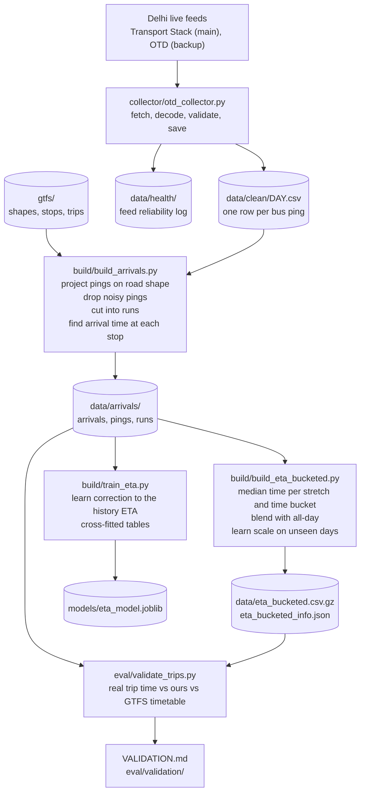
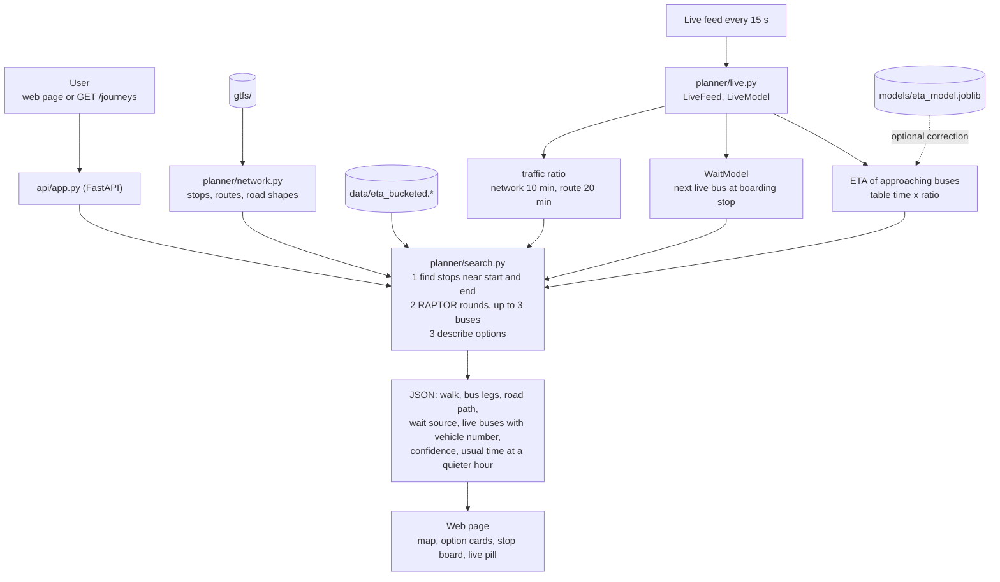

# Pipeline

## 1. Building the learned data (offline)

## 2. Answering a request (online)

## 3. Shared code

`planner/features.py` defines the live traffic ratios and ETA model inputs once. Both `build/train_eta.py` (training) and `planner/live.py` (serving) use it, so the model sees the same numbers in training and in use.
