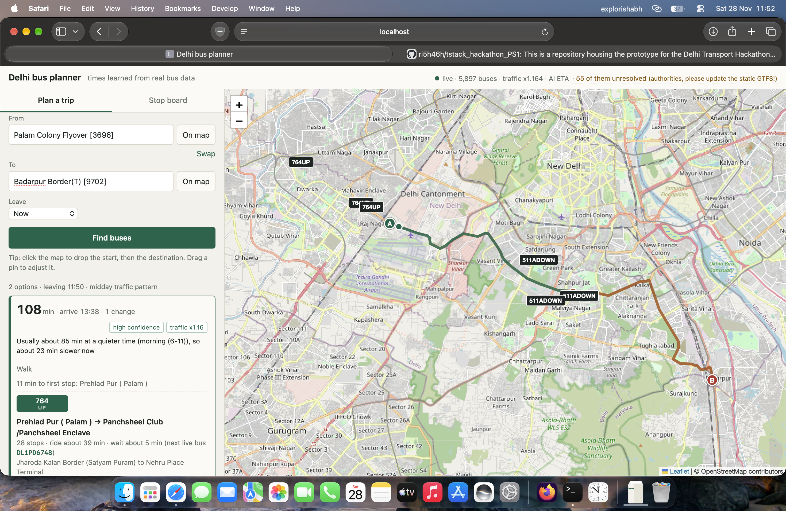
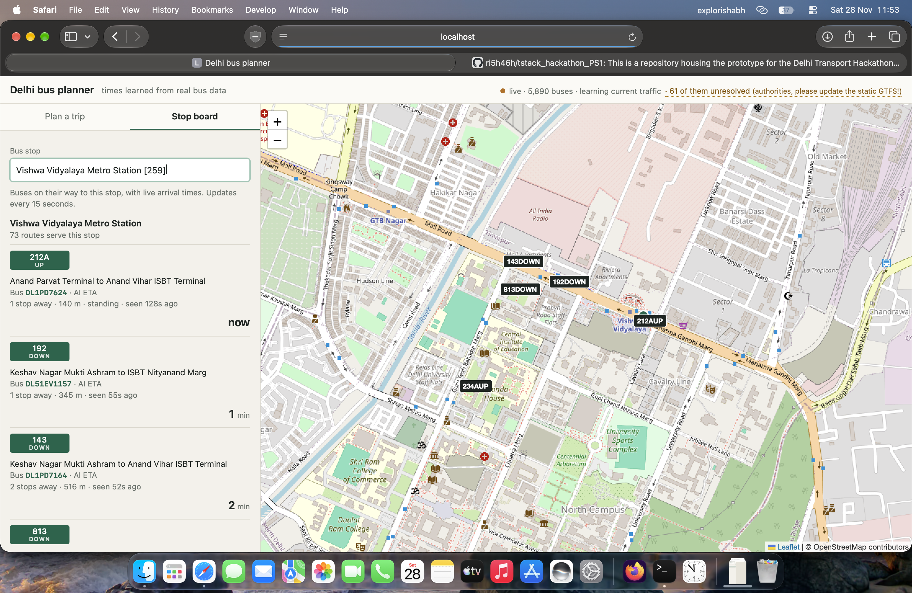

# Delhi bus journey planner

Prototype for the **Delhi Transport Stack Hackathon '26, Problem Statement 1**: plan bus journeys in Delhi using real bus-location data, with travel-time estimates that use both history and live buses.

> [!NOTE]
> PLEASE READ THE IMPORTANT NOTE below :

> [!IMPORTANT]
> Everything is built from **my own collected data** (the GTFS-realtime VehiclePositions feed, saved over several days using a collector script of my own `collector/otd_collector.py`) plus the GTFS static files and the live feed. No sample data from the hackathon (that provided october month data) is mixed in. So as a result, attempting to run scripts 
in `build/` won't work. If the evaluators/juries wish to see how my collected data looks, they can run the collector script (instructions available below) for 4-5 minutes and it will generate the CSVs. However, still don't run any script in `build/` unless 3-4 days of data is collected.

- Journey API: `GET /journeys?from=...&to=...&depart=...` returns options as JSON
- Web screen: map with trip planner, live buses and a stop board
- Learned travel times per stretch of road, by time of day
- Live correction: current traffic, next-bus waiting time, optional AI ETA model
- Each option also shows how long the same trip usually takes at a quieter time of day, so the effect of traffic is visible
- Technical note: [`TECHNICAL_NOTE.md`](TECHNICAL_NOTE.md) (GPS-to-route linking, travel time per stretch, live + history, waiting time, little-data behaviour)
- Validation report: [`VALIDATION.md`](VALIDATION.md) (estimates against real bus trips and the GTFS timetable, 13 held-out days)
- Pipeline diagrams: [`PIPELINE.md`](PIPELINE.md)

---

## What you can do with it

| Screen / endpoint | What it gives |
|---|---|
| `/` web page, tab **Plan a trip** | Pick start and end on the map or by stop name. See up to 3 options with walking, buses, waits, transfers, confidence, the usual time at a quieter hour, and live buses coming to each boarding stop (with vehicle number). |
| `/` web page, tab **Stop board** | Pick a stop. See buses heading there with ETA, stops away, vehicle number. |
| `/journeys` | The documented journey API (below). |
| `/docs` | Interactive API docs (try requests in the browser). |

---

## Quick start (about 5 minutes)

You need **Python 3.11 or newer**.

### 1. Get the code

```bash
git clone https://github.com/ri5h46h/tstack_hackathon_PS1.git
cd tstack_hackathon_PS1
```

### 2. Add the GTFS static files

The GTFS files are not stored in this repo. Copy the GTFS Static files (Download from Transport Stack) into the `gtfs/` folder:

```
gtfs/
  routes.txt   stops.txt   trips.txt   stop_times.txt   shapes.txt   calendar.txt
  (agency.txt and feed_info.txt are fine to include too)
```

The learned ETA table in `data/` is keyed by the route ids and stop ids of the GTFS version we used. If your GTFS version uses different ids, ride times quietly fall back to speed estimates and confidence drops.

### 3. Install the dependencies (pick one way)

**With uv (recommended, faster)**

```bash
# install uv once: https://docs.astral.sh/uv/getting-started/installation/
uv sync
```

**With plain Python and pip**

```bash
python -m venv .venv

# Linux / macOS
source .venv/bin/activate
# Windows (PowerShell)
.venv\Scripts\Activate.ps1

pip install -r requirements.txt
```

### 4. (Optional) Add API keys for live buses

Without keys the planner still works from the learned data. Only the live parts stay off.

```bash
cp .env.example .env        # Windows: copy .env.example .env
```

Edit `.env` and paste your own keys:

```
TSTACK_API_KEY="your key from Delhi Transport Stack (main live feed)"
OTD_API_KEY="your key from Delhi OTD (backup feed)"
```

### 5. Run it

```bash
# uv
uv run uvicorn api.app:app

# plain Python (venv active)
uvicorn api.app:app
```

Open:

- <http://127.0.0.1:8000/> the web page
- <http://127.0.0.1:8000/docs> the API docs

**The first start takes about a minute**: the planner reads the GTFS files and writes a cache (`data/.network_cache.pkl`). Later starts are fast. The cache rebuilds by itself when a GTFS file changes.

When keys are set, a green pill at the top of the page shows the live status (number of buses tracked, traffic factor, and "AI ETA" when the model is loaded).

---

## API

### `GET /journeys`

```
/journeys?from=28.6139,77.2090&to=28.5355,77.2640&depart=now
/journeys?from=stop:1234&to=stop:5678&depart=09:30&max_transfers=1
```

| Parameter | Meaning | Default |
|---|---|---|
| `from`, `to` | `lat,lon` or `stop:<stop_id>` (inside the Delhi area covered by the data) | required |
| `depart` | `now`, or `HH:MM` in IST (24-hour) | `now` |
| `max_transfers` | 0 to 3 | 2 |
| `live` | use live data (only applies when `depart=now`) | true |
| `max_options` | 1 to 5 | 3 |

Response (shortened):

```json
{
  "depart": "21:30",
  "bucket": "night",
  "live": {"applied": true, "network_factor": 1.04, "events": 5120},
  "options": [
    {
      "total_min": 62.4,
      "arrive": "22:32",
      "quiet_hour_min": 51.0,
      "quiet_hour_bucket": "morning (6-11)",
      "slower_than_quiet_min": 11.4,
      "transfers": 1,
      "confidence": "high",
      "data_share": 0.91,
      "legs": [
        {"type": "walk", "minutes": 4.1, "what": "walk to first stop", "path": [[28.61, 77.20], [28.61, 77.21]]},
        {
          "type": "bus", "route": "729DOWN", "route_id": 1234,
          "from": "Stop A", "to": "Stop B", "stops": 17,
          "wait_min": 3.2, "wait_source": "live", "next_vehicle": "DL1PD4080",
          "ride_min": 24.0, "path": [[28.61, 77.21], "..."],
          "live_buses": [
            {"vehicle": "DL1PD4080", "eta_min": 3.2, "stops_away": 4, "eta_source": "model"}
          ]
        }
      ]
    }
  ]
}
```

- `wait_source` is `live` (next live bus) or `timetable` (half the average gap between buses).
- `eta_source` is `model` (AI correction) or `history` (table time x live traffic ratio).
- `confidence` says how much of the ride time came from real stop-to-stop data: `high`, `medium` or `low`.
- `quiet_hour_min` is the usual time for the same trip at the quietest time of day (ride times of that bucket, same walking and waiting). `slower_than_quiet_min` says how much slower the trip is at the chosen departure time.
- `path` follows the road shape from `shapes.txt` where available.

### Other endpoints

| Endpoint | Purpose |
|---|---|
| `GET /live/stop?stop_id=...` | Buses approaching one stop |
| `GET /stops?q=name` | Search stops by name |
| `GET /live/status` | Live feed and live model status |
| `GET /health` | Network size, ETA table days, load time |
| `GET /plan` | Older form of `/journeys` using separate `from_lat`, `from_lon`, `to_lat`, `to_lon` |

---

## How it works (short)

Full detail is in [`TECHNICAL_NOTE.md`](TECHNICAL_NOTE.md).

1. **GPS to route.** Each ping is projected onto its route's road shape. Position is one number: metres along the route. Stops are placed on the shape the same way. Arrival times at stops come from interpolating between pings.
2. **Travel time per stretch.** For each route, stop pair and time bucket (morning, midday, pm peak, night) we keep the median time, blended with the all-day median when data is thin, with a scale factor learned on days the table has not seen.
3. **Live and history together.** Live buses give a traffic ratio (observed time / table time) for the whole network (last 10 min) and for each route (last 20 min). A trained model can correct the resulting ETA further. The wait at a stop is the time until the next live bus arrives.
4. **Search.** RAPTOR-style rounds (up to 3 buses) with short walking links between stops.

**Waiting at stops and signals.** Our stop-to-stop times run from the bus's arrival at one stop to its arrival at the next. So the time standing at stops and at signals is inside the number and is not split out. The ETA model also sees how long a bus has been standing still. The wait for a bus (before boarding) is separate: the next live bus, or half the usual gap between buses when no live bus is found.

**When there is little or no live data.** Nothing breaks. Until enough buses have reported, the traffic ratio stays at 1.0 and the learned table is used as it is. Without API keys the planner runs on the table alone. For a stop pair with too little history, the planner falls back step by step to the route's speed at that time of day, then all day, then the network speed, and the option shows lower confidence.

**Noisy GPS.** Pings that jump, run backwards, are too fast (over 20 m/s), are too far from the route (over 100 m) or have gaps over 2 minutes are dropped before anything is learned.

---

## Project layout

```
api/            FastAPI app (/journeys, /live/stop, /stops, ...) and static page serving
planner/
  network.py    loads GTFS: stops, routes, road shapes; caches the result
  search.py     journey search, waiting times, leg descriptions
  live.py       live feed reader, live traffic ratio, next-bus waits, ETA model hook
  features.py   numbers shared by live serving and training (same definitions)
eval/
  validate_trips.py       checks the estimates against real bus trips and the GTFS timetable
  validation/             summary.md and validation.png from the 13-day run
VALIDATION.md             validation report
TECHNICAL_NOTE.md         technical note
build/
  build_arrivals.py       pings -> stop arrival times, runs and cleaned pings
  build_eta_bucketed.py   arrivals -> travel-time table by time of day
  train_eta.py            trains the ETA correction model
  build_eta_table.py      older, simpler table (not used by the planner)
collector/
  otd_collector.py        saves the live feed to CSV, day by day
web/index.html            the map screen
data/
  eta_bucketed.csv.gz, eta_bucketed_info.json    the learned ETA table (committed)
  clean/ raw/ health/ arrivals/ analytics/       collected data (not committed)
models/         eta_model.joblib and its info file (committed)
gtfs/           put the GTFS static files here (not committed)
tests/          tests for planner, live model, shapes and waits
```

---

## Validation

Full report: [`VALIDATION.md`](VALIDATION.md). In short, on 328,129 stop pairs from real bus runs on days the model did not learn from:

| method | average error | within 20% of real time |
|---|---|---|
| **Ours (time-of-day table)** | **19.0%** (2.5 min) | **64%** |
| GTFS timetable | 30.1% (3.7 min) | 42% |

The test shows the learned table only. The live correction applies to trips starting now and is not part of it. To rerun it you need the collected days (see the note at the top), then:

```bash
uv run python eval/validate_trips.py
uv run python eval/validate_trips.py plot      # chart from the saved results (needs matplotlib)
```

---

## Rebuild the data and the model (optional)

The repo already contains a ready ETA table and trained model, so you can skip this. Do it to reproduce our numbers or to learn from more days.

```bash
# 1. Collect the live feed day by day into data/clean/ (needs keys in .env)
uv run python collector/otd_collector.py run --save-raw

# 2. Match pings to stops: writes arrivals, runs and pings files into data/arrivals/
uv run python build/build_arrivals.py run

# 3. Learned travel-time table by time of day -> data/eta_bucketed*.{csv.gz,json}
uv run python build/build_eta_bucketed.py build
uv run python build/build_eta_bucketed.py check      # honest test on a day it did not learn from

# 4. ETA correction model -> models/eta_model.joblib
uv run python build/train_eta.py train
```

Notes:
- Step 3 needs data from at least 2 days to learn its scale factors on unseen days.
- `train_eta.py` shows progress bars. `--threads N` limits the CPU it uses (0 = all). `--max-cases` and `--step` reduce the training size.
- The planner uses the trained model only if it beat the table x live ratio on held-out data (shown in the training output). If not, it is ignored and nothing breaks.
- With plain Python replace `uv run python` with `python`.

---

## Tests

```bash
uv run python tests/test_planner.py
uv run python tests/test_live.py
uv run python tests/test_shapes_waits.py
uv run python build/build_eta_bucketed.py selftest
uv run python build/train_eta.py selftest
uv run python eval/validate_trips.py selftest
```

They use a tiny made-up network and need no GTFS files, data or keys.

---

## Troubleshooting

| Problem | Fix |
|---|---|
| `FileNotFoundError` for GTFS files on start | Copy the GTFS `.txt` files into `gtfs/` (step 2). |
| First start is slow | Normal. It builds `data/.network_cache.pkl` once. |
| Page loads but "Live data is not running" | No keys in `.env`, or the keys were rejected. Check `/live/status`. |
| Live pill says "learning current traffic" | The live model needs a few minutes of buses before it trusts the traffic ratio. |
| Low confidence on most options | The GTFS ids do not match the ETA table (different GTFS version). |
| Old network after changing GTFS | Delete `data/.network_cache.pkl` and restart. |
| Training says no days with pings | Pings files (`YYYY-MM-DD_pings.csv.gz`) must be in `data/arrivals/` next to the arrivals files. Run `build_arrivals.py` without `--no-pings`. |

---

## Screenshots
- **Journey Planner**



- **Stop Board**




---

## Known limits

- Travel times come only from our collected days, so rarely served stop pairs fall back to speed estimates (shown as lower confidence).
- Only the longest trip pattern of each route is planned.
- Walking uses straight-line distance x 1.3, not footpaths.
- Live data is used only for trips starting **now**.
- Departure time is a time of day (`HH:MM`). Weekdays and weekends are not separated, and a trip uses the time bucket of its departure time for the whole journey.
- `from` and `to` take coordinates or a stop id; typing a stop name works on the web page, not yet in the API.
- Buses that have not left a terminal are not in the feed, so early waits can be underestimated.

---

## Licence

Apache License 2.0, see [`LICENSE`](LICENSE).

Author: Rishabh Narayan
