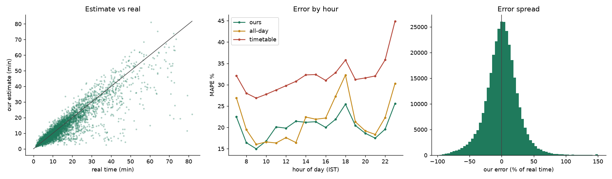

# Validation report

This report checks our travel-time estimates against what buses really did, and against the published GTFS timetable. A comparison with Google Maps is in the last section.

## How the test works

- **Data:** 13 days of our own collected bus positions (2026-10-20, 10-25, 10-30, 10-31, 11-06, 11-07, 11-09, 11-10, 11-18, 11-19, 11-20, 11-21, 11-23). No other data is mixed in.
- **Real times:** for every bus run we pick random pairs of stops A and B on it. The real time is the bus's arrival at B minus its arrival at A. It includes the time standing at stops and at signals.
- **Held-out days:** each day is tested with a table built only from the other 12 days, with the scale factors also learned without it. So the model never sees the trips it is tested on.
- **Estimates compared:**
  - **Ours:** the learned table for that time of day (the same one the planner uses).
  - **All-day:** the same table with one number per stretch for all hours.
  - **Timetable:** the scheduled time between the same two stops in GTFS `stop_times.txt`.
- **Matching to the timetable:** feed trip ids and GTFS trip ids are named differently. We matched each run to the GTFS trip of the same route that starts closest in time and serves both stops. 196,628 of 204,543 trips (96%) were matched.
- **Size:** 328,129 stop pairs (314,320 with a timetable value). Pairs are 3 to 35 stops apart.

The test script is `eval/validate_trips.py`. Full results are in `eval/validation/summary.md`.

## Results

| method | MAE (min) | median error (min) | mean error % (MAPE) | bias % | within 20% of real time |
|---|---|---|---|---|---|
| **Ours (time-of-day table)** | **2.50** | 1.20 | **19.0** | +0.3 | **64%** |
| All-day table | 2.63 | 1.18 | 19.2 | -3.5 | 63% |
| GTFS timetable | 3.68 | 2.07 | 30.1 | +5.1 | 42% |

On the 314,320 pairs where the timetable also has a value: ours 18.9%, all-day 19.1%, timetable 30.1%.

- Our estimates have about 37% less error than the timetable (19.0% against 30.1%). In minutes the average error is 2.50 against 3.68.
- Our bias is close to zero (+0.3%). The timetable overestimates by about 5%.
- 64% of our estimates are within 20% of the real time, against 42% for the timetable.

### By trip length

| trip length | pairs | ours | all-day | timetable |
|---|---|---|---|---|
| 3-4 stops | 134,637 | 21.5% | 21.4% | 34.3% |
| 5-9 stops | 133,966 | 18.1% | 18.5% | 29.3% |
| 10-19 stops | 47,804 | 15.4% | 16.0% | 23.6% |
| 20+ stops | 11,722 | 14.0% | 14.6% | 18.9% |

(mean error %). Short stretches have a larger percentage error because a single wait at a stop or signal is a big share of a short trip.

### By time of day

| bucket | pairs | ours | all-day | timetable |
|---|---|---|---|---|
| morning (6-11) | 112,442 | 16.9% | 18.1% | 28.1% |
| midday (11-16) | 119,822 | 20.4% | 18.1% | 30.0% |
| pm peak (16-20) | 38,649 | 21.4% | 25.2% | 32.3% |
| night (20-6) | 57,216 | 18.4% | 19.6% | 32.9% |

- Using the time of day helps most in the peak hours. At 17:00 the error is 21.9% against 27.3% for the all-day table, and at 18:00 it is 25.5% against 32.3%.
- It also helps in the morning and at night.
- **At midday it does slightly worse than the all-day table** (20.4% against 18.1%), mostly in the hours 11 to 13. The midday bucket covers 5 hours and our collected days contain fewer midday and afternoon hours, so its numbers are less steady. This is a known weak spot.
- Hours 18, 19 and 23 have few test pairs (5,244, 2,430 and 1,071), so their results are less reliable.

### Effect of data coverage

- 324,627 pairs (99%) were on stretches where at least 80% of the segments had real stop-pair data. Their error is 18.9%.
- 3,502 pairs used the speed fallback for more of the route, and their error is 28.9%. This is the cost of having little data on a road.

## What this shows and what it does not

- **Shows:** a model learned from the bus fleet's own movement estimates real bus trip times clearly better than the published timetable, with no bias, and it adapts to the hour of the day where data is available.
- **Does not show:** the live correction. This test uses the learned table only. The live traffic ratio and the AI ETA model apply to trips starting now and were not part of this historical test. The AI model's own held-out result is printed by `build/train_eta.py train`.
- **Limits:** a bus's arrival time at a stop is itself estimated from GPS pings, so some of the error is measurement noise. The comparison is on bus-to-bus times between stops, not on door-to-door trips with walking and waiting. Evening and late-night hours have less data than the morning.